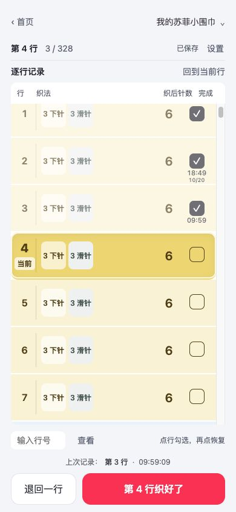

# 苏菲 · 一行一记

一个配合个人织图使用的离线编织逐行计数工具，当前主要面向苏菲小围巾的加针、减针与收尾过程。基于原生 HTML、CSS 和 JavaScript，无后端、无运行时第三方依赖。

当前版本：**v0.10.16**。

## 功能

- 根据起针数、最宽针数、加减针节奏和手法生成逐行操作表。
- 支持 KFB / M1、单侧或交替加减针，以及织到合适宽度后设置转折。
- 勾选完成、退回一行、跳转查看，短暂反馈帮助确认记录成功。
- 每行对勾下方显示完成时间，跨天附带日期；底部保留最近一次记录。
- 最多保存三条作品，各自保留参数与进度。
- 提供围巾形状预览、设置说明和完成反馈，适配手机窄屏。



## 下载与使用

在 [Releases](https://github.com/zhnq/sophie-row-counter/releases) 下载：

- `sophie-row-counter-v0.10.16.html`：内置全部样式和脚本的独立 HTML，适合本地打开。
- `sophie-row-counter-v0.10.16.zip`：小红书离线 H5 小工具上传包，根目录为 9 个正式资源文件。

浏览器版本使用本地存储；符合能力条件的小红书小工具容器使用平台 Storage。作品不会跨设备同步，清理浏览器或平台缓存可能删除记录。不同文件路径、浏览器或来源之间的存储也不自动共享。旧记录没有完成时间时保持空白，不补造历史时间。

这是计数辅助工具。参数应按自己持有的织图填写，形状预览是估算，不替代完整织图。

## 本地开发

使用 Node.js 24；不需要安装 npm 依赖。

```sh
git clone https://github.com/zhnq/sophie-row-counter.git
cd sophie-row-counter
npm run preview
```

打开 <http://127.0.0.1:4173/>。可通过 `SOPHIE_PREVIEW_PORT` 环境变量调整端口。

```sh
npm test             # 自动测试
npm run build        # 构建 build/ 目录和版本 ZIP
npm run build:html   # 导出独立 HTML
```

版本号来自 `package.json`，产物位于 `release/`。构建会检查脚本语法、资源完整性、禁用能力、兼容语法和 ZIP 大小。`build/` 与 `release/` 是可重新生成的产物，不纳入源码提交。

## 目录

| 路径 | 内容 |
| --- | --- |
| `src/` | 正式入口、界面、计数逻辑、存储和形状预览 |
| `tests/` | 参数、行表、存储、容器模拟、交互与构建测试 |
| `scripts/` | 本地预览、ZIP 和独立 HTML 构建脚本 |
| `assets/` | 图标与设计源素材 |
| `docs/` | 设计记录、验收说明与截图，见[文档索引](docs/README.md) |
| `docs/completion-design-qa.md` | 完工反馈的设计验收记录 |
| `CHANGELOG.md` | 近期版本变化 |

本地 `archive/` 集中保留编织工具的早期原生小程序、旧浏览器预览和早期单文件入口，不作为当前发布入口，也不纳入源码提交。`release/` 只保留当前版本安装包、校验文件及图标；试验预览和旧版本安装包已从工作目录清理。

## 验证与发布

当前 281 项自动测试通过。v0.10.16 已核对浏览器下的逐行时间、撤销、刷新恢复，以及 390px / 320px 手机布局；小红书 iOS / Android 容器仍需真机验收。仓库与 Release 的创建不代表已向小红书上传或发布。

发版时先修改 `package.json`，运行测试及两个构建命令，再核对 ZIP 与 `src/` 的文件内容一致。保留独立 HTML 和 ZIP 两种下载格式。
