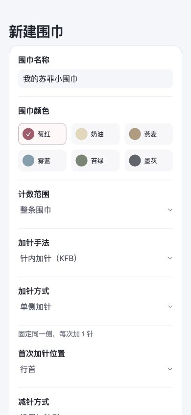
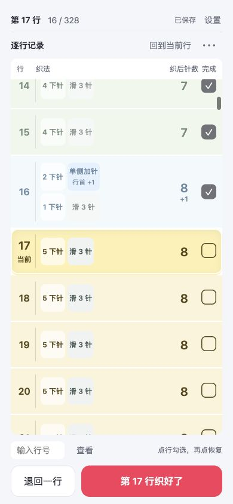

# 首页与进入流程建议

核对日期：2026-10-03。范围仅为首次进入和重新打开后的续织入口，没有改动产品代码。

多作品需求已更新为最多三条，后续首页与保存设计以[三条围巾方案](multiple-scarves-plan.md)为准。下面保留单作品入口的原始核对证据。

## 1. 首次使用：进入新建表单

独立测试端口 4175 没有存档时，首先显示“新建围巾”，并非计数表。字段有清晰名称，但首屏已经包含名称、颜色、计数范围和多种织法选项；最宽针数与开始按钮还在下面。用户需要先理解参数，才能看见自己的作品。

建议先提供简洁的作品首页和“开始一条围巾”，再进入现有设置与预览。首页不重复技术说明、图例或大段介绍。

## 2. 已有记录：直接续织

在独立示例中创建 16 / 328 行的记录后重新打开，进入第 17 行计数表，当前行居中并高亮。这条路径适合织一行、记一行的高频操作，但缺少查看作品全貌和开始另一条作品的入口。

建议在计数页提供返回“我的围巾”的入口；日常重新打开仍直接恢复计数，不强制每次经过首页。

## 建议的首页内容

- 无记录：标题“我的围巾”和按钮“开始一条围巾”。
- 有记录：用实际参数生成的正视围巾预览、作品名称、完成行数／总行数和“继续第 X 行”。
- 全部完成：作品显示“已完成”，提供查看记录入口。
- 读取失败：明确提示记录读取失败，提供重试，不把错误呈现成没有作品。

“继续第 X 行”必须取第一个未完成行；有跳行勾选时，不能用已勾选数量加一。

当前只有一个存档，不支持独立的第二条作品。首页若加入“新建围巾”，应同时支持分别保存作品；否则应明确称“重新开始一条”，并在替换前说明原进度会被覆盖。不能把现有“修改设置”伪装成新增作品。

## 证据与限制

两张截图均来自本轮 390 × 844 的本地浏览器捕获，已打开核对。16 / 328 属于独立示例；用户的原记录未用于保存测试。续织首屏的名称与形状缺失、首次表单的阅读负担属于本轮可见证据；全部完成、读取失败和单作品限制另由源码核对。

标签与选中标记在截图中可见；截图不能确认屏幕阅读器、焦点顺序或小红书真机可访问性。新增首页应使用有明确名称的按钮，保留文字进度和状态，不只用形状或颜色表示信息。
