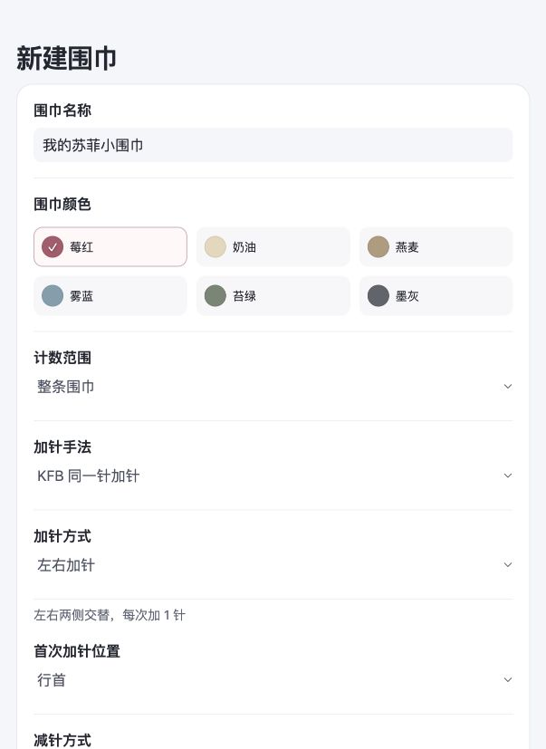
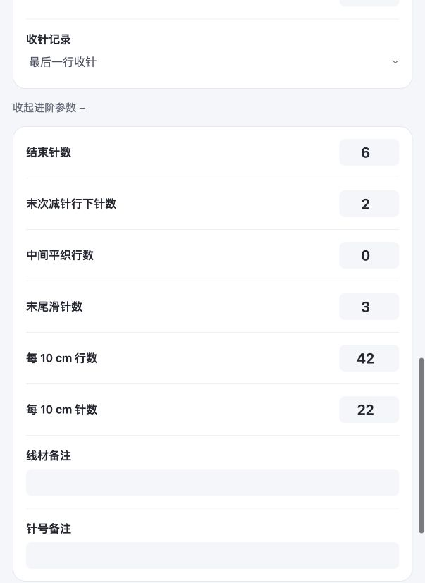
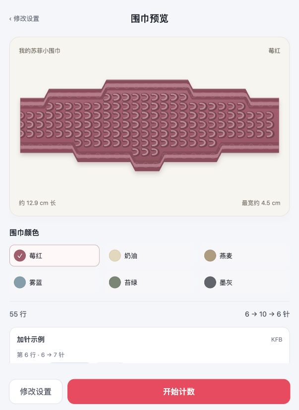

# 新手设置引导与参数联动方案

2026-10-03。针对 v0.7.0 设置流程的改版方案，已在 v0.8.0 实现并完成本地检查，等待用户验收。目标是在填写时看懂结果，减少必须自行推算的数字，同时保留按个人织图调整的能力。实际交付与检查见 [v0.8.0 验收记录](release-audit-v0.8.0.md)。以下“当前流程检查”为改版前的证据。

## 当前流程检查

本轮通过当前浏览器的同一份新建草稿，依次查看设置入口、行数参数、进阶参数和保存前预览。参数为起止 6 针、最宽 10 针、间隔与首次加减针均 6、尾段 6、左右交替；只查看和返回，没有确认新建。

| 步骤 | 当前情况 | 优先改进 |
| --- | --- | --- |
| 1. 设置入口 | 名称、颜色可直接选择，但在针数前就需要理解手法、布边和行首／行尾 | 先填针数和节奏，织法用清楚的分组和摘要；“左右加针”写全为“左右交替加针” |
| 2. 行数安排 | 四个数都填 6，实际含义不同；没有当场显示真实加减针行和前后平织数 | 在字段下显示实际结果，避免靠用户理解内部段内行号 |
| 3. 进阶调整 | “中间平织”与段内首次减针都能延长最宽处等待；密度、边针与备注混排 | 合并中部等待入口；把行内织法与尺寸估算分开 |
| 4. 形状预览 | 能看出形状并查看首两次加针；不解释哪个参数产生了当前轮廓 | 设置时加实时结果和局部图示，预览仍承担保存前复核 |

### 1. 设置入口：术语出现过早



单侧／交替已有一句说明，是可以沿用的做法。问题是“左右加针”的主标签仍可被误读为同一行两边各加一针，针数与长度设置也要向下滚动才能看到。

### 2. 行数安排：同一个数字需要多种解释


“首次加针 6”表示前 5 行不加针；“段内首次减针 6”不是整条第 6 行；“末尾平织 6”是在末次减针后另织 6 行。这些区别目前不在输入旁显示。用户只能先生成，再返回核对。

### 3. 进阶调整：等待参数重复，估算用途不明确



“中间平织”与“段内首次减针”共同决定首次减针的总行号，新手不必同时填写。针密度与行密度需要小样测量，当前字段没有说明它们只改变轮廓比例和厘米估算，不改变行表。

### 4. 保存前预览：能显示结果，原因需要回头找



保持形状预览和真实操作块。填写中加入反馈后，预览用于最后确认，而不是第一次发现参数含义。

上述截图为本轮实际界面。没有进行屏幕阅读器、软键盘和完整键盘遍历检查，不能据此声称无障碍合规。新帮助入口需要有足够点击范围、可朗读名称和明确关闭方式。

## 设置顺序

沿用现有手机页面和风格，分组填写，不增加独立教程页。主流程按依赖从上到下排列：

1. **计数范围**：默认整条围巾；已有进度或只计某一段时展开相应设置。
2. **针数**：起针数、最宽针数。旁边显示“从 6 针加到 10 针，共加 4 次”。最宽针数由个人织图提供，不猜官方尺码。
3. **加针节奏**：加减针间隔、首次加针行。先设置间隔，再看到关联的首次行。
4. **加针怎么织**：单侧／左右交替、KFB／M1、首次行首／行尾、首个和后续行首加针前下针数。首个与后续位置保留在明确的基础分组中，不重新藏入模糊的“进阶参数”。可用摘要“行首加针：首个前 2 下针 · 后续前 3 下针”减少未展开时的占位。
5. **减针与收尾**：结束针数、首次减针行（整条）、减针后平织行数、收针。减针侧默认沿用加针侧，独立侧别放在明确的“调整减针织法”入口。
6. **尺寸估算**：小样每 10 cm 行数和针数，独立折叠。没有测量时只称估算，不把默认密度当作实测值。
7. **其他信息**：名称、颜色、线材／针号备注。已有进度使用“已经开始织了”入口；新建从 0 开始。

所有上游都在依赖它的下游前面。结束针数在起针数后；首次减针总行号在针数、间隔和首次加针后；尾段在首次加针后。

## 三种填写时反馈

### 直接可见的短结果

关键含义放在字段下，随当前有效数值变化，不依赖点问号：

| 字段 | 直接反馈示例 |
| --- | --- |
| 首次加针行 6 | 前 5 行不加针，第 6 行加第一针。 |
| 间隔 6、首次加针 6 | 加针行：6、12、18、24。 |
| 首次减针总行 30 | 第 24 行到 10 针；再平织 5 行，第 30 行减针。 |
| 减针后平织 5 | 最后一次减针后再织 5 行，再收针。 |
| 起针 6、结束 6、首加 6、尾段 5 | 开头平织 5 行，末尾也织 5 行。 |
| 收针记录开启 | 共 54 行，含最后 1 行收针。 |

不生成几十行解释。输入未完成时不把空值当 0，不显示 NaN 或错误轮廓；只提示还需要哪项才能计算。

常用解释直接展示，补充信息按需展开，参考 [GOV.UK 输入提示](https://design-system.service.gov.uk/components/text-input/)与 [补充说明组件](https://design-system.service.gov.uk/components/details/)；关键含义不全部藏进问号。

### 点问号后的短图示

统一为“一句动作说明 + 当前参数示意”，复用真实行表和围巾轮廓，图示配文字，不只用颜色表达：

- **起针／最宽／结束针数**：高亮起端、最宽处或尾端，说明改变的是哪里、针数是变多还是变少。
- **首次加针与间隔**：短行号轴标出平织行和加针行；用当前数值，不固定套 8。
- **单侧与交替**：显示同一布边连续加针，或两条布边轮流加针；每个事件只画一个 +1。“左右交替”明确每行总共加 1 针。
- **首次减针与尾段**：高亮最宽处等待段或最后减针后的平织段，区分两者。
- **KFB／M1 与位置**：显示真实首两次操作块。KFB“在一针上织出两针”；M1“在相邻两针之间挑横线加一针”。
- **M1 倾斜**：解释针目左倾／右倾与在哪条布边加针是不同设置，不让两项互相联动。
- **密度**：用 10 cm 小样的横向针数和纵向行数，说明改变的是估算长宽比例，不改表格行数。

手法和前导下针数改变真实针目、行内操作或边缘结构，但当前轮廓模型不完整模拟这些细节。因此提示不能说“手法不会改变围巾”，也不能承诺形状预览检查出了所有针法问题。

帮助用可点击按钮打开底部面板；支持关闭按钮、Escape、焦点返回触发按钮，参考 [W3C 对话框模式](https://www.w3.org/WAI/ARIA/apg/patterns/dialog-modal/)。不用手机无法操作的鼠标悬停提示；沿用现有离线兼容方式，不依赖较新的浏览器原生弹出层能力。

折叠区也要覆盖帮助，尤其补齐下列容易混淆的设置：

| 设置项 | 短说明与示意 |
| --- | --- |
| 计数范围 | “整条”含加针、减针与收尾；“仅加针／仅减针”只生成这一段。仅减针从最宽针数开始，表内从第 1 行重新计数。 |
| 首次行首／行尾 | 选择第一次加针在这一行开头还是末尾；行尾加针在末尾滑针前。用真实首行操作块标位置，说明翻面后行首不一定仍是同一条布边。 |
| 首个／后续行首加针前下针数 | 分别标出首个、后续位于行首的加针操作；行尾位置以末尾滑针为准，不受这两个前导数调整。 |
| 减针侧别“沿用加针侧” | 第一次减针从最后一次加针所在的布边开始；原来左右交替，减针也交替。图上标出最后一次 +1 和第一次 −1。 |
| 首次减针位置 | 独立选择减针侧时，用首个真实减针行标出行首／行尾；选择沿用时由行表推算，不额外填写冲突的位置。 |
| 减针行首下针数 | 位于行首的减针，先织几针下针，再把两针减为一针。显示该行真实操作块；行尾减针不机械套用行首前导。 |
| 末次减针行下针数 | 最后一次位于行首的减针使用这个数，可以与前面的减针行不同。并排显示普通、末次两行操作。 |
| 末尾滑针数 | 每行末尾有几针滑过、不织下针。标出真实滑针块；它改变边针织法，当前轮廓不完整模拟边缘细节。 |
| 已连续完成行数 | 显示“从第 14 行继续”一类结果；它是从第 1 行连续完成的数量，不是零散勾选总数。已有零散记录时，明确显示修改后将按连续完成重建，仍需通过已织操作保护与保存确认。 |
| 收针记录 | 表格末尾多一行收针，不属于减针后的平织行数；图上分开标出末次减针、尾段平织、收针。 |

名称、颜色和备注不必全部加问号，分别提供用途即可：颜色只改变预览，线材／针号是备注，不改变计数表。实施时统一登记每个字段的说明和图示类型，避免折叠项漏掉帮助。

### 字段旁的即时纠错

只在有足够信息时核对当前组合：

- “首次加针前先织 3 针”与起针 6、KFB、末尾滑 3 针冲突时，指出还需要 1 个原针，不能静默改成 2。
- 手填首次减针早于到达最宽处时，在该字段旁显示最早可选行。
- 首尾平织数不同只是不同设计，不作为错误阻止；显示“开头 5 行，末尾 6 行”，由用户决定。
- 不能执行的针数或超过 4000 行时阻止预览；不会因一个参数临时输入不完整，连锁清空其他字段。

## 联动规则

联动是建议，全部先发生在草稿里，最终仍由预览确认保存。新建时可采用下表默认值；已有作品不在打开设置时重新套用。

| 上游 | 下游建议 | 生效条件 |
| --- | --- | --- |
| 加减针间隔 | 首次加针行 = 间隔 | 有加针段；首次行仍处于自动状态 |
| 起针数 | 结束针数 = 起针数 | 整条；结束针数仍自动 |
| 起针数、最宽针数、间隔、首次加针行 | 首次减针总行 = 最后加针行 + 间隔 | 整条、减针起点仍自动；已有明确中部等待或转折不静默重排 |
| 首次加针行 | 减针后平织 = 首次加针行 − 1 | 整条、默认两端平织数相同的方案；只称平织数对应，不把上下交替台阶说成同时对称 |
| 加针侧别 | 减针侧别沿用加针侧 | 减针仍选择“沿用”；独立手填侧别保留 |

**不联动**最宽针数、实测密度、手法选择、M1 倾斜、首个／后续具体加针位置。KFB 与 M1 切换后检查数量是否可执行，不自动把用户的 2 / 3 改成另一套位置。

模式要分别处理：仅加针段的 tail 是“加针后平织行数”，新建建议 0，不能从首加推算尾端；仅减针段没有首加，首次减针按该段表的行号显示。模式切换保留手填值，隐藏不适用字段，不把隐藏值当成联动来源。

## 自动与手动状态

每个被联动的字段明确区分“跟随建议”与“手动”。

1. 新建时下游以建议值填入，标注来源，例如“跟随间隔”“与起针相同”“首尾平织相同”。
2. 用户亲自输入该字段后，立即进入手动状态。即使恰好输入与建议一样的数字，也算手动。
3. 再改上游时，只更新自动字段。手动字段保持原值，旁边显示新建议；需要时可点“采用建议”重新跟随。
4. 输入框获得焦点、帮助面板打开或程序刷新显示，都不算用户手改。
5. 上游临时非法时保留所有下游值，等有效后再更新建议。不要在用户清空数字准备重输时触发级联重置。
6. 既有作品缺少联动状态记录时全部视为固定，不根据“值等于默认值”推断自动。未来新增的联动状态按作品单独保存；重新打开设置本身不重算，用户明确修改上游后，才更新仍自动的下游。
7. 已织行保护继续在试算和确认时执行。任何联动改变已勾选行的真实织法，都不能保存；不能用重置进度绕过。

例：间隔填 6 时首加建议 6。用户把首加改成 8 后，后来改间隔为 10，首加仍保持 8；首次减针和尾段如果仍自动，就基于 8 与新的间隔重新计算。手填尾段同样不会被首加变化覆盖。

## 首次减针的统一表达

主界面使用 **“首次减针行（整条）”**，同时显示最宽后实际等待多少行。“中间平织”不再作为第二个可编辑等待入口，内部参数可为兼容而保留。

这不是只改标签。当前存储为段内 firstDec，需要真正换算：

```text
L = firstInc + (max − start − 1) × interval
A = max(L, turnAfterRow)
D = A + center + firstDec
```

新建默认 center 为 0，D 建议 A + interval。旧存档显示上述实际 D，但未编辑时保持原始 center / firstDec，不因为打开设置就重写。

用户明确修改 D 后，gap = D − A，可在原普通整条允许的 1…600 范围内分解为 firstDec = min(gap, 100)、center = gap − firstDec。换算不额外改变用户填写的 D；减针及后续行按新 D 排列，再核对已织操作。例如 D 从 30 改为 34，间隔仍为 6，减针行从 30／36／42／48 移到 34／40／46／52。

上述 1…600 只用于普通整条的中部等待换算。既有“设为最宽处”专门流程保留 anchor + 1…anchor + 100 的范围与已织锁定，不能因为合并字段而放宽该入口。

## 当前数字示例

起针 6、最宽 10、间隔 6，在新建且下游仍自动时：

- 首次加针建议第 6 行；加针行 6、12、18、24。
- 结束针数建议 6。
- 第 24 行到 10 针；首次减针建议整条第 30 行。
- 开头 5 行不加针，末尾建议再织 5 行。
- 减针行 30、36、42、48；末尾平织 49…53，收针第 54 行。

这组数字已用当前生成器核算。它是联动规则示例，不是官方 Sophie 尺码预设，也不代表所有用户都应选择这种织法。

## 实施验收重点

- 间隔先设、首加在后，自动值可看出来源；亲自修改后不再被上游覆盖。
- 起针变更只联动仍自动的结束针数；最宽针数始终由用户填写。
- 首加手改后尾段按该首加建议，不错误跟随间隔减一。
- 仅加针、仅减针不套用整条尾端规则。
- D 与旧中间等待正确转换，不显示内部局部行号；旧存档未编辑原样保留。
- 首 2 / 后 3 易于找到，KFB/M1 切换不自动移针；非法组合就地指出。
- 帮助图例、计数表、当前动态行号使用同一份计算；不能各自套固定示例。
- 三条作品的手动状态、旧参数、勾选与转折各自独立。
- 帮助面板手机可点、键盘可开关、关闭后焦点返回；新手首次进入不自动弹出一长串教程。
- 调整任何参数后，已织行和保存失败保护保持；取消设置和取消预览都不写入。
