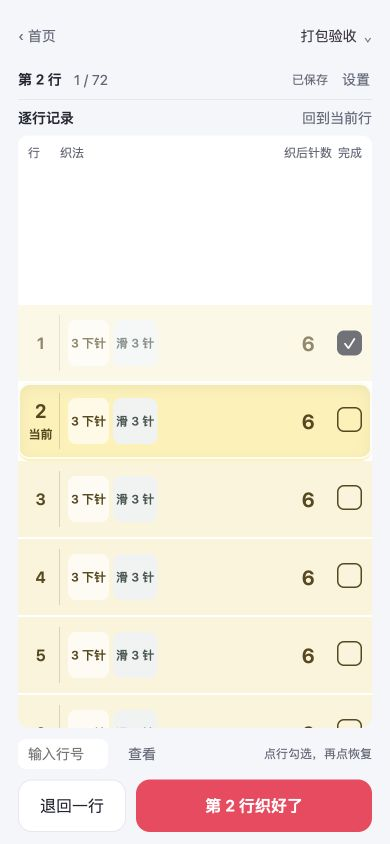

# v0.10.4 小红书小工具打包检查

检查日期：2026-10-03。交付对象为离线 H5 小工具 ZIP。

## 核对依据

- [小红书当前容器文档](https://miniapp-sandbox.xiaohongshu.com/minitool/doc)，本次获取页面标注更新于 2026-09-22。
- [官方分发的 minitool-zip-builder 包](https://fe-static.xhscdn.com/minitool/20260923133933/minitool-zip-builder-1.7.0.skill)，已读取 SKILL.md 及 ZIP、端能力、JS、CSS、跨端、性能六份规范。下载文件名为 1.7.0，内置 SKILL.md 自述版本为 1.6.0；未将社区脚手架文档当作平台规范。

## 本轮处理

1. 按当前规范补平台 Storage JS API：9.46.0+ 且所需方法可用时使用；客户端版本从启动参数获取，并忽略编译序号。浏览器兼容存储保留给无 SDK、未知版本或低版本环境。
2. 补旧库迁移与失败保护：优先已有平台库；空平台库迁移可读取的 browser v2 / 单条旧记录，保留旧原文。损坏存档不覆盖；SDK 失败不静默回退。
3. SDK 超时不使按钮永远等待；尚未结束的请求阻止后续 SDK 操作，响应结束后重读存档确认状态。当前实例操作排队，作品修订号用于检测陈旧修改。
4. Canvas 创建失败时用当前轮廓与纱色生成 SVG 简图，清掉旧纹理；无法生成轮廓时显示短提示。
5. 加强构建扫描，拒绝禁用能力、网络资源、未兼容 API、错误入口及视口。SVG 标准命名空间不是网络资源，校验只豁免该命名空间常量。
6. 更新 README 与版本号，避免历史说明指向旧发布包。
7. 修正保存超时后的草稿重试：同一编号只接受参数和进度完全相同的幂等重试；修改过的草稿报冲突。页面也核对保存结果，避免预览与实际存档不同却显示保存成功。

## 规范清单

| 项目 | 本轮核对 |
| --- | --- |
| ZIP 入口 | 根目录唯一 index.html，没有外套文件夹 |
| 包内内容 | 9 个 HTML / CSS / JS 静态文件，资源均 ./ 相对引用 |
| 脚本与 CSP | 经典外置脚本，按依赖顺序加载；无内联脚本、行内事件、module、eval、Function、WASM、自建 CSP meta |
| 离线与端能力 | 无网络、CDN、定位、剪贴板、Worker、外链、新窗口或系统下载；存储按公开 SDK 使用条件选择 |
| JS 基线 | ES2017 静态核对；额外验证无 Promise.finally 的环境能初始化与重试 |
| CSS 与跨端 | Grid 用 grid-gap，Flex 用 margin；安全区、高度与焦点有基础路径，PointerEvent / visualViewport 检测后使用 |
| 性能设计 | Canvas 2D，DPR 上限 2；无 WebGL、媒体、静态数据库或 Base64 大资源；最长 4000 行虚拟渲染 |
| 内容隔离 | 不包含测试、文档、旧 miniprogram 目录、source map、构建配置、依赖、密钥或用户进度 |

## 验证结果

结论：本地静态规范核对与回归通过，可提交平台验收；尚未在平台模拟器或真机验证。

| 检查 | 结果 |
| --- | --- |
| 完整自动回归 | 247 / 247 通过，0 失败、0 跳过；其中 28 项平台存储模拟回归、5 项预览降级回归 |
| 官方体积审计 | 构建目录及最终 ZIP 均 PASS：9 个文件、0 警告 |
| ZIP 结构与 CRC | 根目录恰好 9 个预期文件；`unzip -t` 全部通过 |
| 内容一致性 | ZIP、构建目录与源码的 9 个文件逐字节相同 |
| 压缩体积 | 59,776 字节（58.4 KiB），低于官方建议的 2 MiB 和上限 10 MiB |
| 解压体积 | 220,488 字节（215.3 KiB） |
| 交付包 | `release/sophie-row-counter-v0.10.4.zip` |

SHA-256：

```text
199ddc6cdeeec51376bea6e77f0349c2a3b32fdebc881b91cebb9530723ebfba
```

随包另有 `.zip.sha256` 校验文件；它不进入上传 ZIP。

本地浏览器回归使用独立端口 4183 的存档：新建 6→10→6 针、72 行，保存第一行后重开，从第二行继续。没有修改原 4173 页面中的用户记录或未保存设置。此结果只作为开发回归；平台 Storage 行为使用 SDK 模拟测试，未声称真机已通过。



## 上传后的验收

使用本次交付的同一 ZIP，在创作服务平台模拟器完成完整功能验证，再分别用 Android 和 iOS 真机扫码验证：新建、最多三条、切换、勾选/撤回、设置/预览、转折、退出重开以及保存失败。Chrome 61 / Android 8.1 兼容性、软键盘、安全区、系统回收后的存储与实际性能均未真机实测。

公开 SDK 未提供原子 compare-and-set；平台路径的当前实例队列和写前校验不能承诺跨独立 WebView 的原子保存。浏览器路径原有 IndexedDB 跨标签页事务保护保留。本机存档也不保证永久保留。

本轮完成本地校验与打包，尚未上传或发布。平台上传页若提供不同版本的改写口令，需按其当前口令再次核对。
