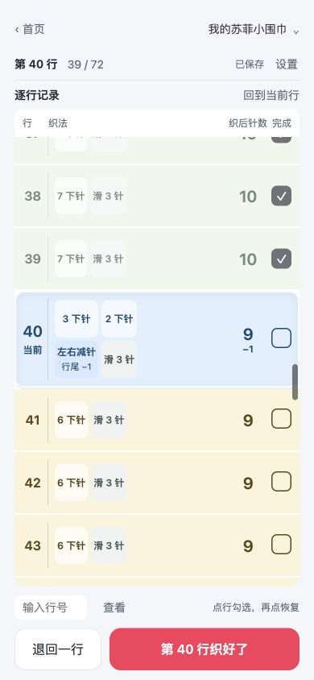
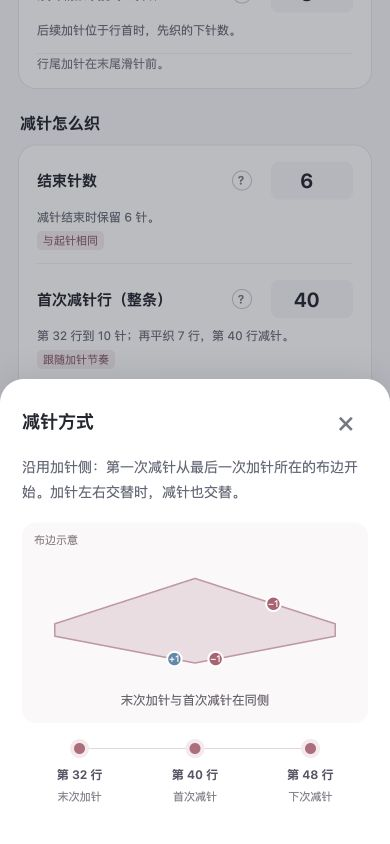
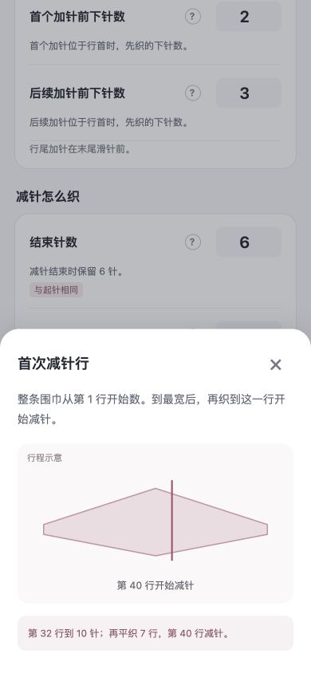
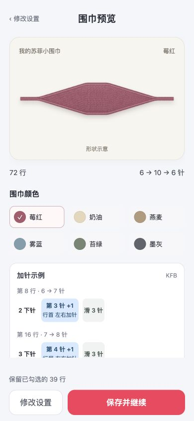
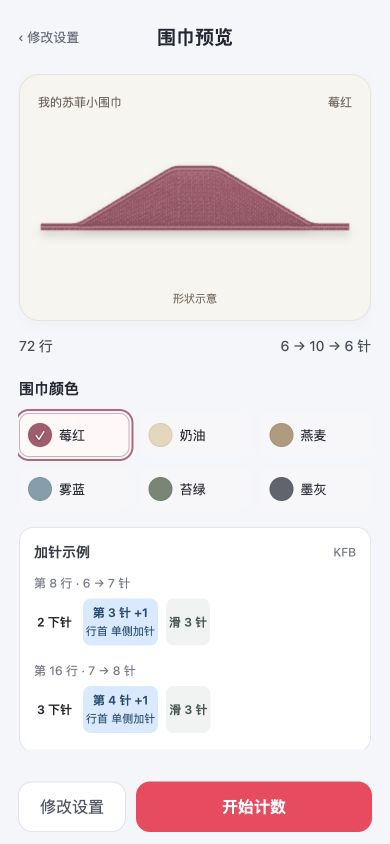
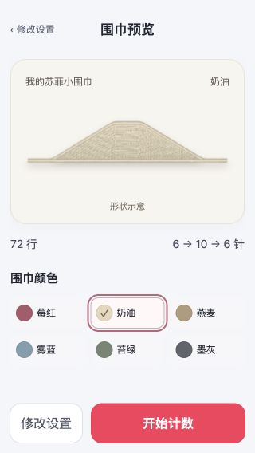

# v0.10.0 设置与形状示意通查

2026-10-03。本地检查通过，等待验收。未发布。

## 修改结果

- “加针怎么织”与“减针怎么织”固定展开，移除加针标题的加号和折叠操作。
- 移除“尺寸估算”及密度设置，预览不再显示厘米数。
- 起针、最宽、结束针数、加减针侧别、首次减针行、尾段等问号图统一使用稳定的轮廓，避免填完参数后切换成不规则多边形。
- “沿用加针侧减针”保留真实行号和布边标记；首次减针行用一条线标记，例如第 40 行。
- 围巾预览和首页缩略图共用新的形状示意：单侧形成长三角轮廓，左右交替形成菱形轮廓，阶段连接平滑。
- 将总行数和起针 → 最宽 → 结束针数移到颜色选项前，缩短预览卡片，窄屏也能先看到核对信息。

## 形状示意的范围

预览用于识别侧别和变化阶段，不估算实物尺寸。画面统一展示比例，并缩小端部的视觉宽度；实际起止针数仍在图下显示。最宽处等待、尾段平织及旧记录的独立减针偏移仍参与轮廓生成，较长的等待会呈现平台。

行表继续使用真实参数计算。起针数、最宽针数、结束针数、变针行和总行数不因轮廓平滑而改变。旧记录中的密度字段保留兼容，但不再控制图形展示。

## 逐步审查

1. **首页与续织：通过。** 原作品仍为 1 / 3 条，已织 39 / 72 行；继续织进入第 40 行。当前行位于表格中间，已织行仍勾选。
2. **设置：通过。** 加针与减针内容均直接显示，未发现尺寸估算或密度输入。首个前 2 下针、后续前 3 下针仍可配置。
3. **问号帮助：通过。** 侧别帮助中，第 32 行末次加针与第 40 行首次减针在同一条布边，第 48 行沿交替逻辑切到另一边。首次减针图标示单条第 40 行线；按 Escape 关闭后焦点回到原问号按钮。
4. **形状与颜色预览：通过。** 已保存的左右交替作品与未保存的单侧试样均无原先的错位折角。切换颜色可更新试样。预览显示实际 72 行、6 → 10 → 6 针，原作品提示保留已勾选的 39 行。
5. **窄屏与返回流程：通过。** 320 × 568 下没有横向溢出，总行数、针数在颜色选项前可见，底部按钮可用。取消新建试样后仍只有原来的 1 条作品，计数未改变。

## 验证结果与范围

- 全部 **204 项测试通过**。覆盖行表、侧别联动、动态帮助图、平滑轮廓、三条作品存储、旧记录兼容与已织行保护。
- JavaScript 语法与构建检查通过。构建包：`release/sophie-row-counter-v0.10.0.zip`，54.0 KiB，含 9 个静态资源。
- 浏览器检查尺寸为 390 × 844 与 320 × 568。本次没有保存试样或修改原作品的已织计数。
- 本结论针对本地浏览器及自动化测试；未执行小红书平台发布环境、完整屏幕阅读器或实物织成尺寸验证。

## 本次截图

