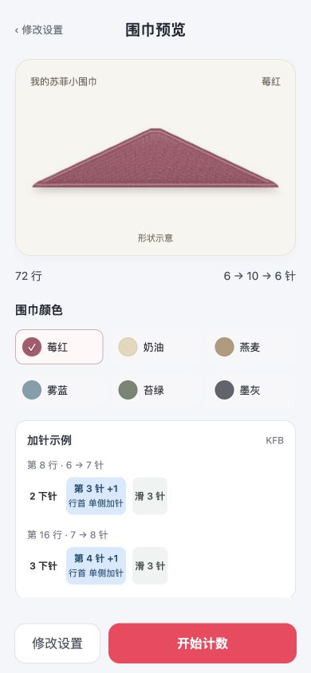
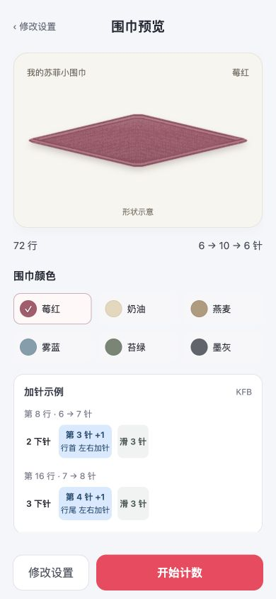
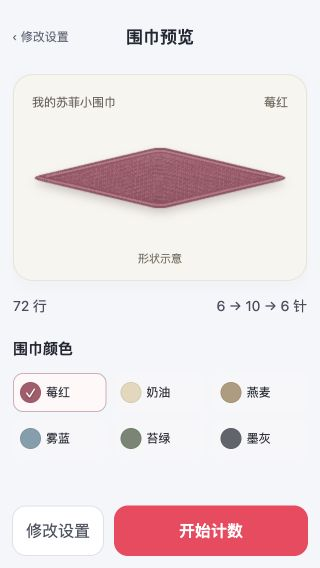

# v0.10.2 三角轮廓预览

2026-10-03。本地检查通过，等待验收。未发布。

## 修改

- 最终预览改用更接近三角巾的展示轮廓。单侧保持一条直边；左右交替仍在两侧展开。
- 从两端到最宽处连续收尖，移除宽端直切造成的方头。最外端只有很短的圆润过渡，不增加细长绳头。
- 短平织段在展示中缩短，使常规 7 行的峰顶平台更紧凑。较长的最宽等待仍明显可见；较长的首尾平织保留直段，避免被画成持续加减针。
- 轮廓采用单调的针数变化与三角包络混合，不再逐像素对应真实针数比例。图仍标“形状示意”；实际针数、行号及总行数继续由原行表计算，未改变存储与计数逻辑。
- 首页缩略图与最终预览共用同一画法。

## 验证

1. **单侧：通过。** 6 → 10 → 6 针、72 行，轮廓更接近三角，直边和收尖方向正确。
2. **左右交替：通过。** 相同参数保持双侧展开，未误画成单侧轮廓。
3. **窄屏：通过。** 390 × 844 和 320 × 568 下无横向溢出，行数、针数和底部按钮可见。
4. **实际参数：通过。** 回归覆盖长首段 99 行、长峰顶等待 180 行、长尾段 90 行；这些长平织仍保留平段。半段的宽截断端与纯平织矩形保留，单次变针加长等待不会被尖端过渡吞掉。

全部 **210 项测试通过**，其中轮廓测试 32 项。真实计划、实际几何与针数信息不受展示处理影响。语法与构建检查通过：`release/sophie-row-counter-v0.10.2.zip`，55.0 KiB，含 9 个静态资源。

本次浏览器检查没有保存试样；用户原草稿标签页未刷新或修改。小红书平台运行及实物尺寸未验证。

## 截图

