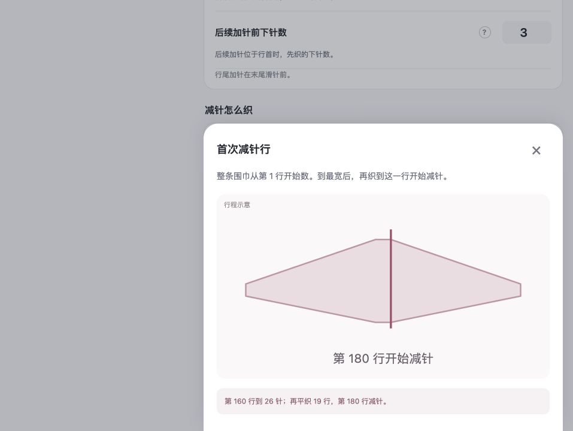
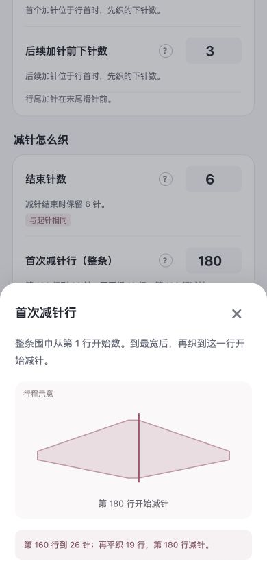

# v0.10.3 首次减针示意图检查

修正问号弹窗中的首次减针示意图：达到最宽针数后，继续平织的部分显示水平边；首次减针红线放在平织结束、开始收窄的位置。

## 核对案例

- 起针 6 针、最宽 26 针、间隔 8 行、首次加针第 8 行、首次减针第 180 行。
- 第 160 行完成最后一次加针，达到 26 针。
- 第 161～179 行保持 26 针，共 19 行平织。
- 第 180 行开始减针。图中的水平段结束位置与红线重合。
- 修改首次减针行时，水平段长度与红线位置按照实际行表更新。仅减针段也使用相同的示意逻辑；无有效行表时展示通用示意，不编造行号与平织行数。

## 验证

- 全部 214 项测试通过；其中帮助示意图测试 29 项。
- 构建通过：9 个静态资源，发布包 `sophie-row-counter-v0.10.3.zip`，55.3 KiB。
- 浏览器实际核对第 180 行案例，桌面与 390 × 844 手机视口均正确显示水平段；手机页面宽度 390，无横向溢出。
- 使用独立、未保存的测试草稿检查，没有覆盖用户原有页面中的草稿。

本次只修正帮助图的行程表示，没有调整行表生成、进度保存或成品预览的形状算法。以上为本地验证，尚未发布到小红书。

