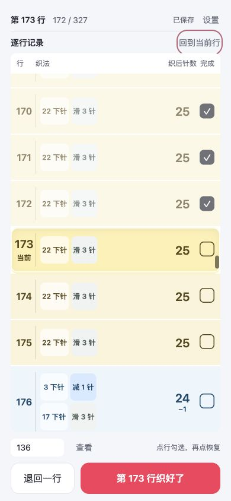
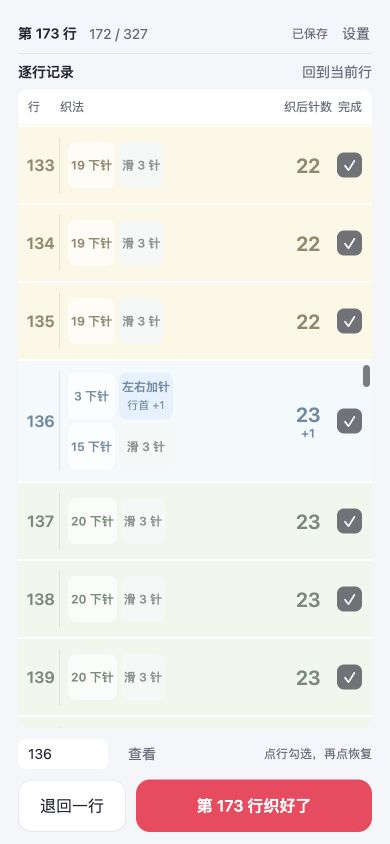
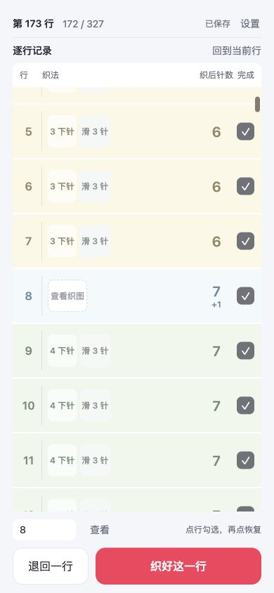
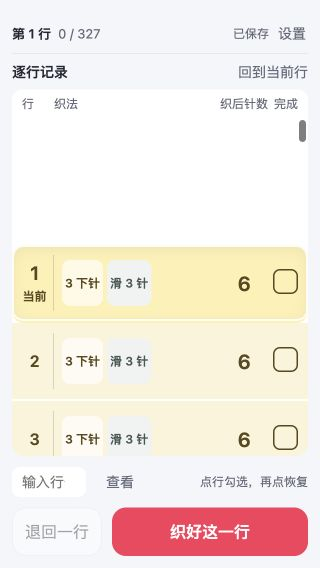
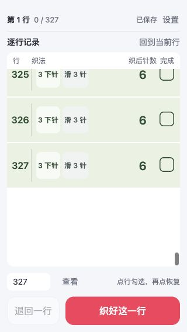
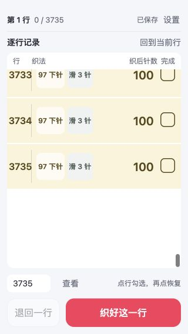

# 苏菲围巾小工具发布前审查

审查日期：2026-10-03。对象是从原生小程序迁移后的离线 H5 小工具 v0.2.0，审查范围包括初始化、续织、勾选与撤回、保存、定位、手机布局、编织提示及上传包。

**结论：记行功能有用，暂缓公开发布。** 已有织图且熟悉参数的用户可以试用；目前不能作为“官方 Sophie 全程照表织”的工具交付。22 项自动检查全部通过，但这些检查不能证明实际围巾织法正确。

## 发布前必须解决

### 1 数字块与自行选择加针手法不一致

代码固定按加针消耗 1 个原针计算。第 136 行织前 22 针，显示“3 下针 / 左右加针 / 15 下针 / 滑 3 针”。在一针里前后各织一下时，原针消耗为 3 + 1 + 15 + 3 = 22；从两针之间加出一针时，加针不消耗原针，后续应该是 16 下针，否则会剩 1 针。

这会直接误导照操作块织的用户，是发布阻断。设置中一次选择加针类型即可，行内仍只显示简短加针块，不需要把 KFB/M1 写在每一行。依据：[Craft Yarn Council 缩写表](https://www.craftyarncouncil.com/standards/knitting-abbreviations)与[TKGA 加针资料](https://www.tkga.org/wp-content/uploads/issue_archives/2019/Fall/BS_SB_Skill%20Building%20Upload.pdf)。代码：`src/pattern.js` 第 51 行。

### 2 减针位置没有与设置闭合

加针可选行首、行尾或交替，减针却始终放在开头下针之后。首次加针设为行尾时，第 160 行行尾加，第 168 行行首减；这两个动作所在布边没有独立核对依据。间隔为奇数时，减针也没有补偿工作方向，可能在相反布边减针。

针数统计仍正确，但围巾形状可能与使用者织图不符。发布前要明确减针位置并做方向测试；不能擅自猜它一定跟随加针或固定在行首。代码：`src/pattern.js` 第 53、64 行。

### 3 默认计划没有完成官方织图校准

6 → 26 → 6 针、8 行间隔、末尾 7 行得到 327 行，来自早期局部截图和示例假设。默认第 8、320 行显示“查看织图”，起止针数还不能小于 6，未验证官方起尖、转折、收尖和收针。

[PetiteKnit 官方页](https://www.petiteknit.com/en/products/sophie-scarf)提供结构、尺寸、密度和 KFB/SKP 教程，完整织图另以 PDF 提供；公开网页不足以核实当前全部默认值。可以把它定位为配合自己的织图使用的计数表，但不能把当前默认值标成官方大小号。要承诺官方版全程可用，需要逐项核对实际织图并实织关键位置。

## 使用流程与截图

以下截图均在本次审查采集并逐张查看。现有用户的计数记录没有因审查而重建；首次生成、完成、重开、撤回和长表测试使用 localhost 的独立测试存档。

| 步骤 | 操作 | 判断 |
| --- | --- | --- |
| 1 | 首次打开、新建围巾 | 能进入；参数多且已有未校准默认值，需改善 |
| 2 | 已有进度续织 | 通过：读到已有进度，当前行明显 |
| 3 | 打开设置 | 布局已修正；还缺加针类型和减针位置 |
| 4 | 错误参数、返回 | 通过：间隔 1 被拦截，返回不写入错误计划 |
| 5 | 查看第 136 行 | 定位通过；操作块数字的适用范围有问题 |
| 6 | 查看尖端第 8 行 | 没有编造负针数，但关键织法留空，不是完整教程 |
| 7 | 320 × 568 小屏完成、重开、撤回 | 通过：第 1 → 2，重开仍为 2，撤回回到 1 |
| 8 | 查看最后第 327 行 | 通过：末行可居中，查看不改变当前进度 |
| 9 | 生成 3735 行、查看末行 | 通过：末端只挂载 7 个行节点，查看仍保留当前第 1 行 |

### 1 新建

用户无需读长篇说明，但仍要填写或理解多个编织参数。新手不能通过当前预填值确认自己在织官方哪一版。需要核准预设或明确自定义方案，不能仅靠一句“按织图填写”消除错误默认值造成的信任风险。

### 2 续织

顶部已压成一行，黄绿分组、当前标记和行号分隔清楚，常用按钮留在底部。恢复记录与首个未完成行一致。

### 3 设置

发现并修正数值输入框占满整行导致中文标签挤成竖排的问题；数值与标签现在分列，辅助技术标签也改为中文。设置页仍较长，这不是记行过程的负担，但对初次配置有门槛。

### 4 校验

错误计划未生成。错误提示位于表单底部；将来可把提示直接放在相关字段附近，减少回找。开头下针数超过实际针数仍可通过校验并让所有变针行退化为“查看织图”，应另加参数之间的校验。

### 5 变针

小屏按编织顺序从左到右、再到下一排读块。查看其他行时，底部按钮已明确写“第 173 行织好了”，避免用户误以为按钮记录屏幕中间的第 136 行；点行仍仅切换该行。

### 6 尖端

对已有织图的熟练用户可以作为行数占位；对希望逐块照织的新用户不够。尖端属于实际任务的必经步骤，不能拿中段正常显示代替完整流程验收。

### 7 小屏记录

主按钮可见，完成与撤回有效。首次行前面有留白，使当前行仍处在屏幕中部。

### 8 末行

末行后留白，定位没有被列表底端截断。查看行和待织行各自有明确行号。

### 9 长表

实际检查了大计划生成与末行跳转，没有一次渲染 3735 个行节点。此结果不是 Android 旧设备帧率或内存实测。

## 已修复的实现问题

- 设置页数值输入框与中文标签互相挤压。
- 输入的无障碍名称暴露内部参数键，改为中文字段名。
- 顶部安全区与全屏高度叠加：安全区移入同一盒模型。
- 窗口变化无条件跳回待织行：改为保留正在浏览的附近行。
- 查看其他行时底部按钮的目标模糊：直接显示会记录的行号。
- 损坏存档缺关键参数却静默套用默认表：现在拒绝读取并保留原存档。
- 静态构建检查对带字符串参数的禁用调用漏检：已补回归检查。
- 发布文档仍指向原生小程序流程：已更新，小程序旧源码另行备份。

## 已通过与尚未验证

22 项自动检查覆盖针数与分组、转折、位置交替、单行勾选、撤回、漏行、存档、写入失败回滚、旧记录兼容、损坏参数与构建约束。目录与 ZIP 各通过静态体积审计，均为 6 个文件、0 警告，候选包约 13.6 KiB。预览使用禁止联网、内联脚本和动态执行的 CSP。浏览器错误日志检查未出现脚本错误。

仍未完成：小红书 iOS/Android 实际容器、软键盘与系统安全区、App 被回收后重开、升级或清理后的进度行为、旧 WebView 61、屏幕阅读器与完整键盘操作、对比度测量、真实编织用户试用。

独立本地存储可用，但官方并不保证永久保留，也不提供本工具当前实现中的跨设备同步：[官方容器能力说明](https://fe-video-qc.xhscdn.com/fe-platform-file/104101b8323q4m0uaga06277180ac7t8006ptl0e12ek1g)。当前一条作品的范围明确；若用户同时织两条，需要作品切换，第一版尚未覆盖。

## 发布条件

先解决三项编织阻断，增加参数关系校验，再在 iOS 与 Android 小红书内完成闭环验证，至少让一位熟悉官方 Sophie 的用户实织起尖、第一次加针、最宽转折、第一次减针与收尖。通过后才适合面向普通苏菲围巾用户公开发布。

本次已完成小工具迁移与候选包构建，**未上传、未公开发布**。
