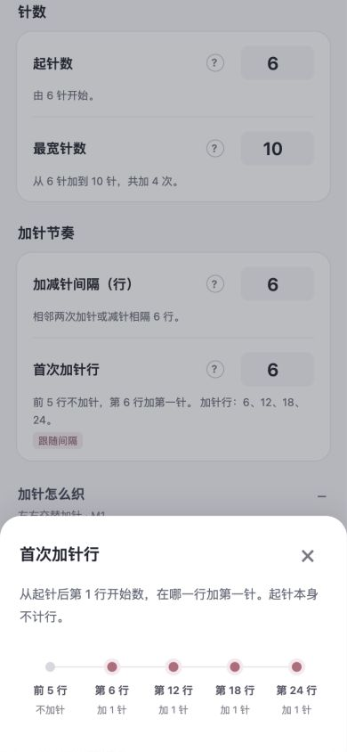
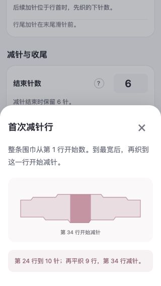

# v0.8.0 设置引导验收

2026-10-03。结论：本次本地检查通过，可交给用户体验新版设置流程。未上传、未发布。

## 本次交付

- 按计数范围、针数、加针节奏、加针织法、减针与收尾排列设置；减针织法、边针、密度、已有进度与备注分别折叠。联动的结束针数、首次减针、尾段位于其上游参数之后。
- 输入框下显示当前数字的实际结果，例如前几行不加针、具体加针行号、最宽行、等待行数和总记录行数。帮助按钮按需展开对应时间线、轮廓或真实针上／针间操作块。
- 整条围巾的首次减针改为整条行号，中部等待不再分成两个字段。仅减针模式仍从该段第 1 行开始计数。
- 新建时首次加针默认跟随间隔，结束针数跟随起针数，首次减针跟随加针节奏，尾段默认与开头平织行数相同。最宽针数仍需按织图填写。
- 用户手动修改后，该字段停止自动跟随；上游变化仅提示新建议。点击“采用建议”才恢复跟随。打开旧作品时不重新套用新建默认值。
- 切换计数范围保留各范围的首次减针及侧别选择。尚未填完、暂时不适用的数字不阻挡当前范围预览，切回后恢复原输入供补填，保存重开同样保留。
- 输入时仅更新结果与错误提示，不重建输入框。保留既有最多 3 条作品、保存前预览、稀疏已织行保护、确认保存重新生成比较等流程。

## 四步体验检查

### 1. 进入设置并填写针数

390 × 844 下，针数与节奏先于织法出现。起针 6、最宽 10、间隔 6 的示例立即显示加针 4 次、首次第 6 行、后续 12／18／24 行。示例只留在验收草稿，未保存到用户作品库。

### 2. 查看参数含义

问号打开帮助面板，时间线使用草稿真实行号。帮助可点关闭、点遮罩或按 Escape 关闭，关闭后焦点返回原帮助按钮。帮助与采用建议按钮均保留 44 像素点击范围。

### 3. 调整减针与收尾

320 × 568 下，手动首次减针第 34 行、尾段 6 行保持不变，旁边分别提示建议 30／5，需主动采用才替换。轮廓标示最宽处的等待段。字段标签与输入框无重叠、无水平溢出。首次减针早于最宽行时当场提示并阻挡预览。

### 4. 预览、保存和重新进入

在独立 `127.0.0.1:4178` 测试库，设置 KFB／M1、首个前 2 下针／后续前 3 下针、左右交替、手动首次减针 34／尾段 6，生成 59 行并保存。重载后参数与自动／手动状态保留。只勾选第 6 行再改手法，被已织行保护拦截，取消后原记录保留。

另确认首次加针留空时，切到仅减针可正常预览；切回整条后空值仍保留，没有被自动默认值掩盖。用户 `4173` 作品库未写入本轮测试数据，原编辑标签页未刷新。验收页读取到两条已有围巾，并另开新建草稿供查看效果。

## 验证

- `node --test --test-reporter=spec tests/*.test.js`：157 项通过，0 失败。覆盖依赖自动／手动状态、采用建议、无效上游、旧参数保留、模式转换、保存重开、候选行比较及已织保护。
- 独立只读复审：2,498 个场景通过。其中 2,160 组计数范围、针数、间隔、布边与手法组合核算 75,336 行；另检查 225 个手动减针／尾段组合、54 个旧作品非织法修改、36 个侧别切换、23 个控制器保存／转折场景。
- 复审发现的模式侧别丢失、隐藏未填字段阻挡预览问题已修复；补充 8 个定向检查通过。
- `npm run build` 成功。`release/sophie-row-counter-v0.8.0.zip` 为 50,405 字节（49.2 KiB），包含 9 个静态文件；新增 `settings.js` 已在页面和构建包中加载。

检查范围为本地浏览器及计算逻辑。手机软键盘、屏幕阅读器、小红书实际容器和实织尚需真机验收，不能据此声称全部设备均无问题。

## 用户验收

打开 `http://127.0.0.1:4173/`，在新建草稿中修改间隔，观察首次加针、首次减针和尾段变化。手动修改首次加针后再次修改间隔，确认其数值保留；点“采用建议”恢复联动。点问号查看对应图示，再预览轮廓与前两次加针，核对后保存。
