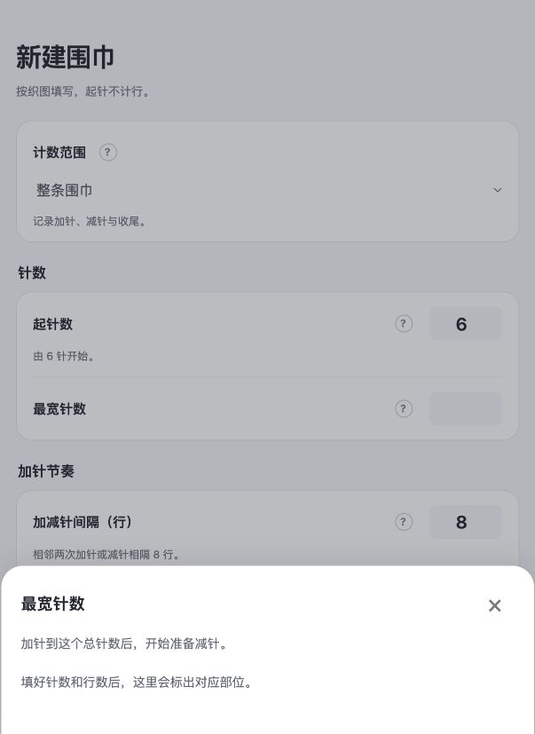
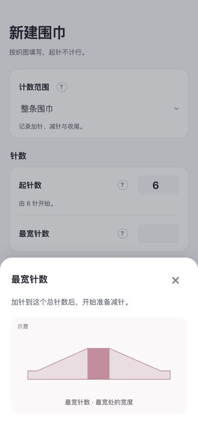
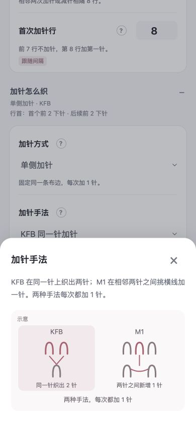

# v0.8.1 问号图示修复

2026-10-03。已修复并完成本地检查，等待用户验收。未发布。

## 原因与修改

上一版部位和布边图依赖完整行表校验成功。新建时最宽针数为空，或其他字段无效，帮助便只显示“填好参数后”的文字；SVG 资源没有丢失，但引导出现得太晚。

- 未填完或参数无效时，起针、最宽、结束、最宽处等待、尾段和布边方式仍显示标注“示意”的图，不使用虚构针数或行号，也不更改输入。
- 参数有效后，部位和布边继续使用真实行表轮廓与事件行号。
- 加针手法加入 KFB 同一针织出两针、M1 两针之间新增一针的比较图。针目倾斜、加减针位置、行首下针和滑针加入针目区块示意；有效设置另显示实际操作区块。
- 间隔或首次变针行未填时，时间线显示动作顺序，保留填写过程中的视觉引导。

## 验证

- 全部 166 项测试通过。新增 9 项回归，覆盖 23 个帮助键在 5 种未填／错误状态下的图示，以及真实数据保留、手法比较、布边语义、行尾加减针位置、帮助不改参数。
- 浏览器复现空白最宽针数时的文字占位，修复后在 390 × 844 下看到最宽处图示；同样未填时可查看 KFB／M1 比较。
- 填最宽 10 针后，首次减针帮助恢复真实第 40 行、最宽第 32 行和中部平织 7 行。320 × 568 下 M1 行尾图与实际首两次操作可见。未保存测试草稿。
- 构建包已同步更新为 `release/sophie-row-counter-v0.8.1.zip`。

证据：

