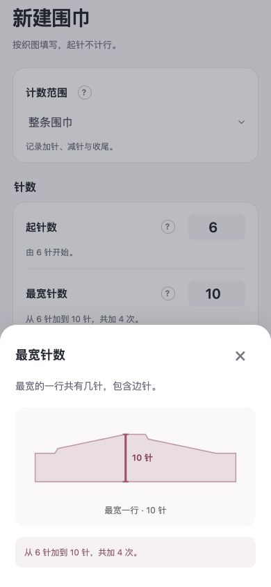
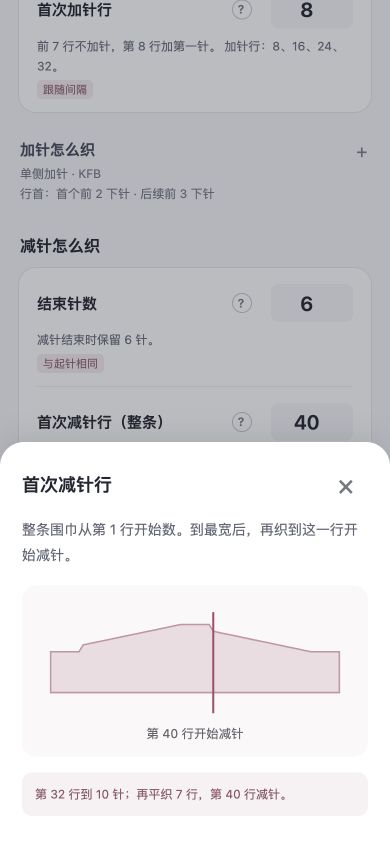
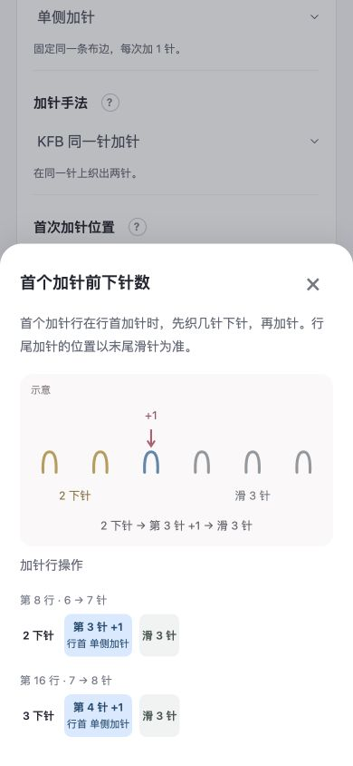
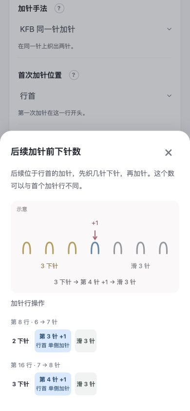
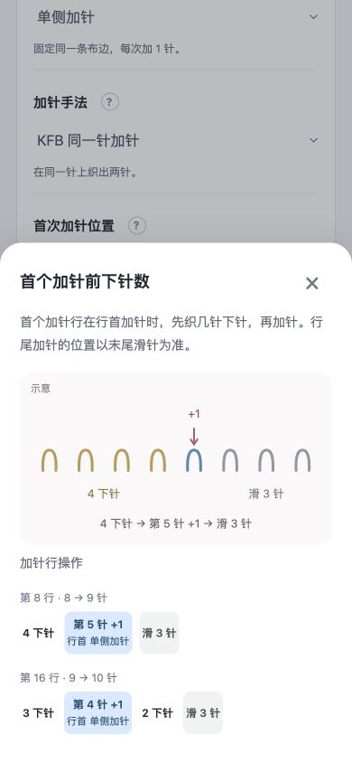
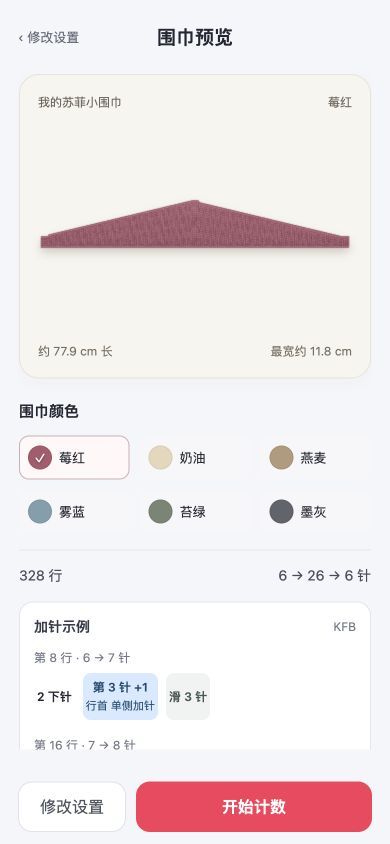

# v0.9.0 设置与示意图调整

2026-10-03。本地检查通过，等待用户验收。未发布。

## 修改

- 起针数表示第 1 行开始时的针数，包含边针。最宽针数表示最宽一行的总针数。起针、最宽和结束针数的图示均沿 Y 轴标示。
- 首次减针行用对应行的一条竖线标记；例如第 40 行，不再用一段色带代替。
- 加针前下针图跟随填写的数字、针数和手法更新。新建默认首个前 2 下针、后续前 3 下针：KFB 分别在第 3、第 4 个原针目加针；M1 显示相应针间位置。大数字用省略针目与实际数量标注。
- 配置顺序为加针怎么织、减针怎么织、收尾。移除独立减针方式、首次减针位置、减针和末次减针的行首下针数、边针设置。
- 新建记录的减针沿用加针侧：单侧固定同一条布边，左右交替在两边交替，每个变针行仍只变 1 针。第一条减针布边跟随最后一条加针布边；仅减针段使用共用的原加针方式。
- 旧作品打开或修改名称、颜色及普通数值时保留原来的隐藏织法。明确修改加针侧别才启用侧别联动；仍保留旧下针数与边针数，已织行保护继续生效。
- 帮助图与拟真预览使用平滑显示边界连接同侧、同阶段的变针事件。原行表、尺寸比例、起止针数、最宽处等待、尾段平织和实际布边均保留。

## 轮廓含义

单侧加针并沿同侧减针呈长三角轮廓。起止 6 针有实际宽度，图中保留端部，不能画成零宽尖端。左右交替在两条布边扩张后收回，仍会呈菱形；平滑只弱化逐针阶梯，不将它改画成单侧三角。旧独立减针造成的偏移也不会被隐藏。

## 验证

- 全部 189 项测试通过。覆盖动态首 2 后 3 图示、手改 4 下针、M1 针间位置、Y 轴针数、第 40 行单线标记、配置顺序、模式切换、侧别联动、旧记录兼容及稀疏已织行保护。
- JavaScript 语法检查与构建检查通过。ZIP 包含 9 个静态资源，无外部资源；`release/sophie-row-counter-v0.9.0.zip` 为 52.9 KiB。
- 浏览器在 390 × 844 下核对最宽 10 针、第 40 行、首个 2 下针、后续 3 下针和手改 4 下针的图示。
- 新建单侧示例 6 → 26 → 6 针、间隔 8 行：首次加针第 8 行、最宽第 160 行、首次减针第 168 行、尾段 7 行，共 328 行（含收针）。预览平滑且与实际行表一致。
- 浏览器验证未保存测试围巾，保留原草稿标签页。新版在新标签页打开供验收。

## 证据

