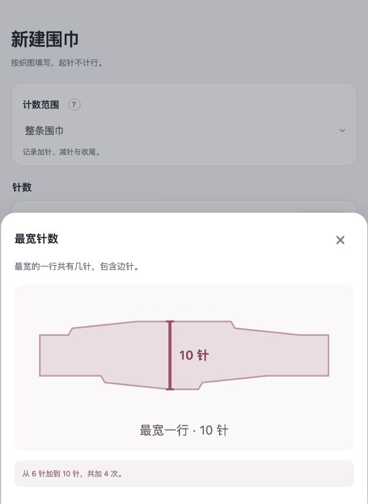
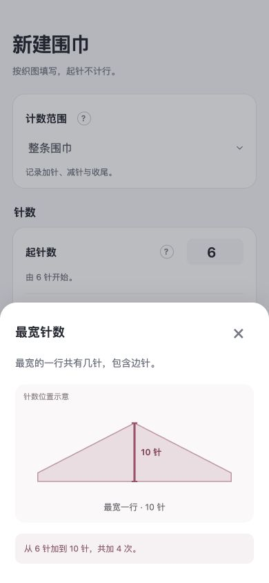
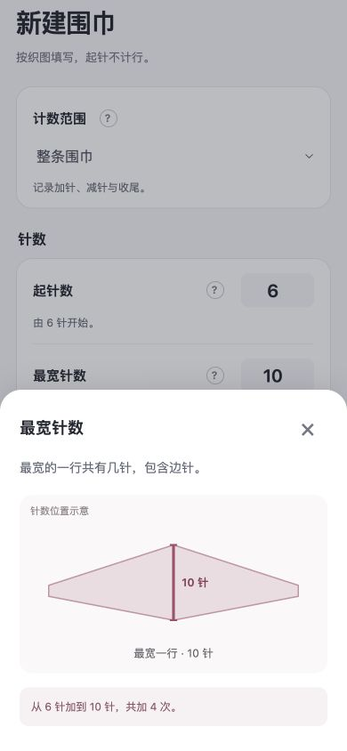

# v0.9.1 针数帮助轮廓修正

2026-10-03。本地检查通过，等待用户验收。未发布。

## 原因与修改

最宽针数未填时显示概念图，填入有效参数后却切换成实际行表的轮廓。6 → 10 → 6 针、左右交替时，较宽的端部、各边先后变针和平织等待形成多个折角，干扰了针数位置的说明。

起针、最宽和结束针数的问号帮助统一使用稳定的概念轮廓，标注“针数位置示意”。单侧显示三角轮廓，左右交替显示菱形轮廓，均保留短平端。竖向针数标线和文字仍跟随填写的数字更新；说明图不按数值比例伸缩。

首次减针行、平织段、布边事件帮助仍按实际行表标记。成品预览、计数表、参数联动及旧作品未改动。

## 验证

- 全部 192 项测试通过。新增 3 项覆盖未填、有效与无效参数、最宽 10/26 针、不同行数、单侧/交替、半段模式和草稿保护。实际首次减针帮助仍校验平滑轮廓与行表一致。
- 浏览器复现当前参数的问号多边形；修正后在 390 × 844 下核对单侧与左右交替。左右交替的最宽数由 10 改为 26 时，轮廓点保持相同，标注变为 26 针。
- 测试草稿未保存，原草稿标签页保留。构建包更新为 `release/sophie-row-counter-v0.9.1.zip`。

