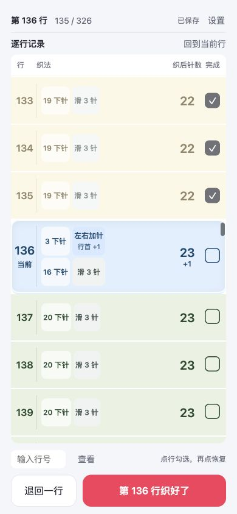
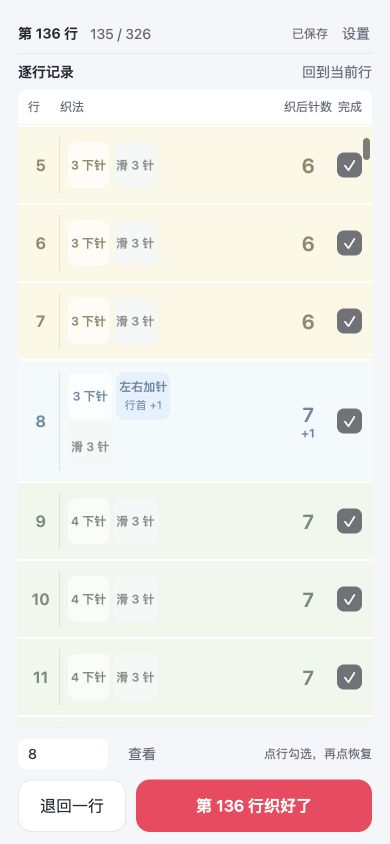
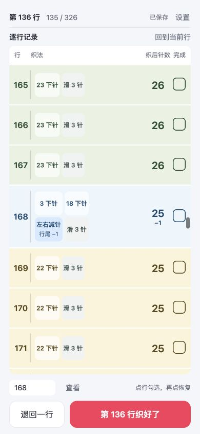
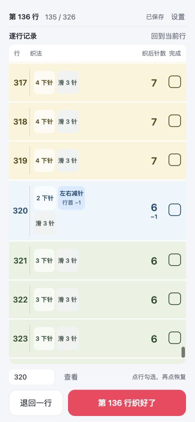
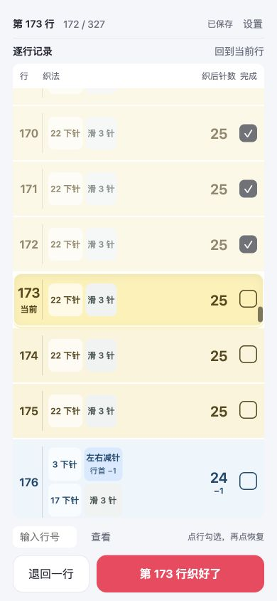

# 苏菲小工具修复复审

版本：v0.3.0；日期：2026-10-03。原 v0.2 审查与截图保留在 [历史报告](release-audit-v0.2.0.md)。

**结论：原先三项实现阻断已处理，可作为“配合自己的织图计数”的候选版本进入小红书真机验收。尚未公开发布，也不称为官方 Sophie 完整织图。**

## 本轮修复

| 原问题 | 处理 | 验证 |
| --- | --- | --- |
| 固定消耗 1 原针却允许自行选择加针手法 | 设置选择针内／针间加针，分别消耗 1／0 原针；行内不显示技法名 | 22 针示例的中间下针分别为 15／16；完整计划逐行原针守恒 |
| 减针固定行首，奇数方向和中间平织可能换布边 | 默认沿用最后加针的布边；支持独立单侧／左右交替减针；用全局行号换算行首／行尾 | 奇偶间隔、奇偶首行、奇偶中间平织、两种首次位置组合测试 |
| 默认 327 行被当成官方方案，尖端留空且没有收针 | 新建最宽针数和末尾平织行数留空必填；首个加针、末次减针独立下针数量；末尾可添加收针记录 | 6→7 与 7→6 原针守恒，收针织后为 0，未勾收针仍有待完成行 |
| 错误前导针数使变针行全部变成占位提示 | 下针、变针原针、滑针必须合计适配当行；不适配直接拒绝生成 | 错误首加、常规加减、末次减针及空白／布尔值参数拦截 |
| 更新规则可能错置旧进度 | 旧计划补齐操作细节，保留行号、针数、总行数；不自动追加收针 | 全部 327 行对应验证，稀疏完成记录和再次存储恢复验证 |

补充来源包括两份 [Ravelry 一手修改笔记](https://www.ravelry.com/projects/MyCraftingJournal/sophie-scarf)及 [另一份完成作品笔记](https://www.ravelry.com/projects/knittingchick50/sophie-scarf)、[Chloé 的 Sophie 实织记录](https://consciousbychloe.com/2026/03/11/sophie-scarf-petiteknit-pattern-review/)、行业技术资料和合法公开的独立免费变体。证据性质及完整规则见 [调研与计数规则](research-and-design.md)。没有使用付费织图镜像，不把独立变体包装成官方尺码。

## 浏览器闭环验证

测试使用 localhost 独立存档，未修改用户 127.0.0.1 的真实勾选或未保存设置。

- 390 × 844：切换加针手法后，第 136 行的中间下针由 15 变为 16；行号、针数和进度保留。当前行中心为屏幕 y=422，无横向溢出。
- 首个加针行明确显示数字块，未出现“查看织图”。
- 第一个减针行放在跟随的行尾位置；末次减针明确显示 2 下针、减针、滑 3 针。
- 320 × 568：收针成为待完成行，底部显示“第 17 行收好了”；记录后重开仍为完成，撤回后回到第 17 行。按钮位于屏幕内，无横向溢出。
- 清空最宽针数或末尾平织行数时拒绝保存；返回后原进度仍为 16 / 17。
- 浏览器错误日志未出现脚本错误。
- 重开实际预览读取到原有第 173 行、172 / 327 的记录；未写入或重建真实进度。

32 项自动检查全部通过。v0.3.0 ZIP 约 15.2 KiB，包目录与 ZIP 静态审计均为 6 个文件、0 警告。

### 针间加针与当前行

### 起尖

### 减针位置

### 末次减针

### 小屏收针

### 原进度恢复

## 发布边界

自动测试和 ZIP 静态审计结果见项目 README。浏览器验证不能替代真实编织，也不能证明小红书容器行为。仍需在小红书 iOS／Android 验证关闭重开、软键盘、安全区、长列表和系统回收后恢复；让熟悉 Sophie 的用户按自己持有的织图试织起尖、最宽转折、第一次减针和收尾。

当前支持一条作品、本机保存。最宽针数、末尾平织、首次转折等按个人织图填写；只记录加减针位置与数量，不替用户决定针目倾斜或具体收针手法。

未上传、未公开发布。
