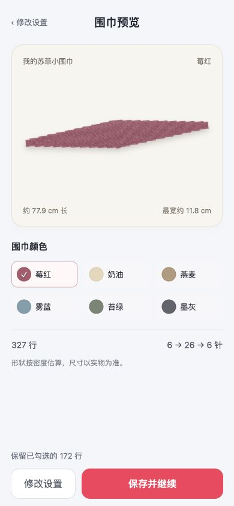
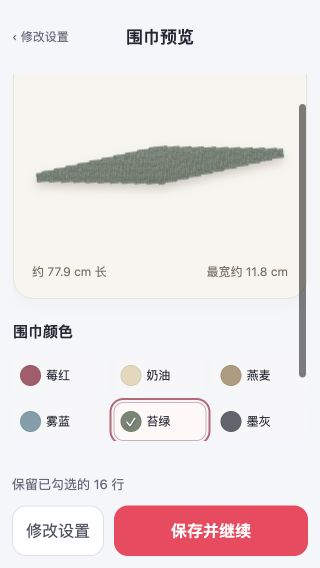
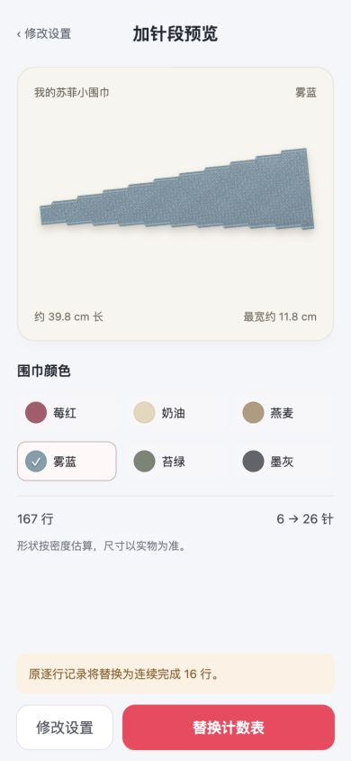
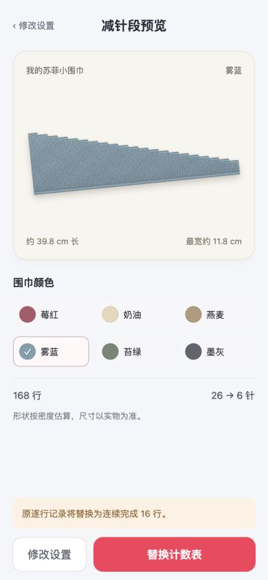
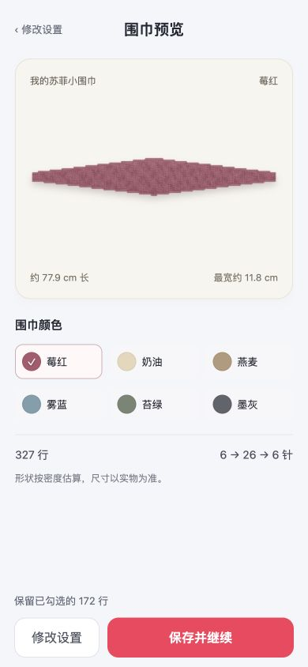

# v0.4.0 围巾形状预览

设置完成后先预览，再确认保存。预览使用准备提交的同一份计数表，不另建一套织图规则。

## 形状计算

`src/shape.js` 读取实际 `plan.rows`，以起始针数建立上下边界，再逐行根据 `delta` 和 `fabricEdge` 移动对应布边。每行上下边界的距离须与该行织后针数一致；针数或布边不一致时直接报错。

- 单侧加减针保持同一条布边，左右交替按变针事件轮换；实际位置由计数核心处理全局行方向，预览不按“行首／行尾”重新猜侧边。
- 中间平织延长最宽平段，末尾平织延长细端；不改变这些行的宽度。
- 仅加针、仅减针显示对应段落，保留宽的截断端，不补成整条围巾。
- 起止针数保留实际宽度，不强行画成零宽尖端。收针行的针上数量为 0，但织物宽度保持收针前宽度；该行不增加预览长度。

行数方向每行换算为 `10 / gaugeRows` cm，针数方向每针换算为 `10 / gaugeStitches` cm；画布只使用一个统一缩放系数，保持长宽比例。默认参考为每 10 cm 22 针、42 行，来自 [PetiteKnit 官方 Sophie Scarf 页面](https://www.petiteknit.com/en/products/sophie-scarf)。用户可在进阶参数中填写自己的针密度和行密度。

最宽显示的是某一行的最大布宽，长度不包含收针行。针数包含已有边针，不额外给两侧各加 3 针。

## 画面与颜色

`src/preview.js` 用离线 Canvas 在实际轮廓内绘制搓板针凸纹、圆润绳边、同纱色明暗和轻投影。纹理和边线是示意，没有使用联网图片，也没有模拟线材的物理垂坠、卷曲或定型结果。

可选 6 色：莓红、奶油、燕麦、雾蓝、苔绿、墨灰。设置和预览页都可选色，颜色只改变预览纱色，不改变逐行计数、布边规则或表格的黄绿蓝区段。

这是一张平放形状估算图。边针的圆形结构、线材和个人松紧会影响实织尺寸；厘米数显示“约”，不能当成尺寸保证，也不代表官方完整织图。产品只保留一句提示：**“形状按密度估算，尺寸以实物为准。”**

## 保存流程

1. `generate()` 校验参数，生成 `previewPlan` 并进入预览；此时不写存档、不替换正在使用的计数表。
2. 选色只更新草稿与预览颜色；“修改设置”返回未保存草稿，可以继续调整并重新预览。
3. `confirmPreview()` 才保存并提交。新建显示“开始计数”，兼容修改显示“保存并继续”；不兼容修改明确显示“替换计数表”，同时列出替换后的连续完成行数。
4. 兼容修改保留全部勾选，包括跳行记录。返回修改或取消设置不保存、不覆盖旧进度。保存失败停在预览并保留旧表，可重试。

旧存档缺少颜色或针密度时采用莓红、22 针的参考值，行号和完成记录不变。

## 开发与验收

入口脚本顺序为计数核心、存储、形状计算、Canvas 绘制、控制器及页面；预览和发布 ZIP 使用同一份离线源码。运行 `npm test` 检查规则及保存边界，`npm run build` 检查并打包小工具资源。

当前 54 项自动测试通过，覆盖形状与实际行表一致、单双侧、部分段落、平织段、密度比例、收针处理、色彩校验、预览确认、取消、保存失败和旧存档兼容。自动测试不能替代小红书手机端验收。

手机验收重点：

- 同样针数分别选单侧与交替，轮廓应随布边规则变化；奇数间隔和奇数中间平织仍对应同一布边。
- 更改最宽针数、间隔、平织行数或密度，预览应保持比例并更新估算尺寸；收针不使末端塌到零宽。
- 六种颜色均能显示清晰纹理和选中状态；窄屏预览不裁切，修改设置不丢草稿。
- 预览与选色后退出，重开仍为旧存档；最终确认后重开恢复新颜色、密度及勾选记录。
- 不兼容修改取消后保留旧表；保存失败不得显示保存成功或提前替换旧进度。

## 本地浏览器验证

2026-10-03，390 × 844 与 320 × 568：轮廓成功渲染，无横向溢出；预览中切色后保留按钮焦点，小屏内容单独滚动，底部保存操作与提示不遮挡颜色按钮。确认雾蓝后重开仍选中雾蓝，16 / 328 行记录恢复；改成苔绿后返回并取消，重开仍为雾蓝。仅加针显示 6 → 26 针，只有减针显示 26 → 6 针，均保留宽的截断端。浏览器未记录脚本错误或警告。

实际 127.0.0.1 存档仍为 172 / 327 行；新版本打开该计划并进入预览后显示保留 172 行，本轮未确认替换或写入真实进度。测试写入使用 localhost 的独立存档。

v0.4.0 构建成功，ZIP 约 21.5 KiB；包目录和 ZIP 静态审计均为 8 个文件、0 警告。54 项测试通过。

### 用户现有计数表预览

### 小屏切色

### 仅加针、仅减针

上述验证为本地浏览器检查，小红书实际手机容器尚未实测。

## v0.4.1 水平正视图

去掉展示旋转，围巾长度轴水平。仍使用同一个缩放系数保留长宽比例，几何、纱色和计数规则不变。390 × 844 浏览器验证轮廓成功渲染，原 172 / 327 行记录保留。构建成功，ZIP 约 21.4 KiB，静态审计为 8 个文件、0 警告。

