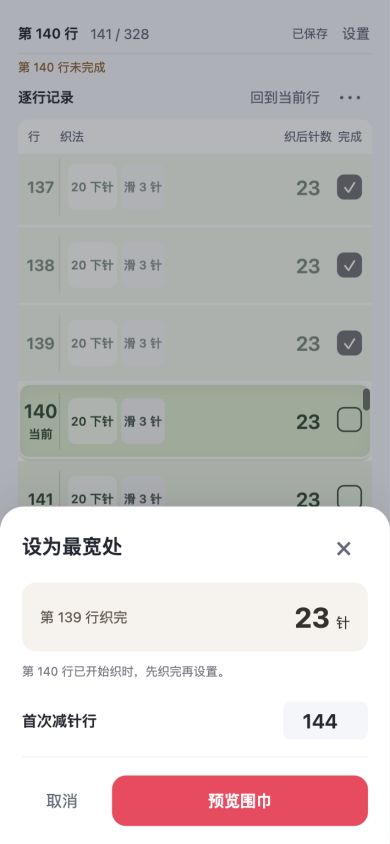
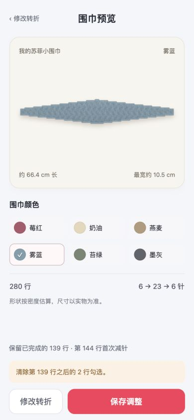
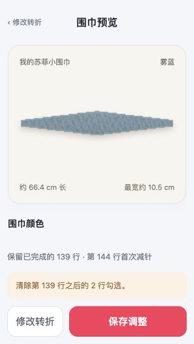

# v0.5.0 设为最宽处

织到合适宽度后，可以把最近连续织完的一行设为最宽处，后方改为减针段。调整保留已织部分，先看围巾预览，再确认保存。

## 入口与操作

- 在逐行记录右侧的“更多”菜单选择“设为最宽处”；也可长按当前行或最近连续完成行 600 ms。
- 长按移动超过 10 px、滚动、松开或取消指针时取消计时。长按成功和拖动后的点击会被拦截，不能顺带勾选或撤回一行；针法按钮不触发长按。
- 入口只在已有加针、当前仍处于加针段、实际针数大于结束针数且尚未设置转折时出现。仅减针、中间平织、尾段、收针及已转折计划不开放入口。

弹层显示最近连续完成行 `R` 和这一行织后的实际针数。跳行勾选不提高 `R`，当前未完成行也不会被自动计入。第 `R + 1` 行若已开始织，应先取消调整，织完并记录后再设置。

首次减针默认放在原计划的下一变针行，即最后一次已完成加针行加上间隔行数。可填写 `R + 1` 到 `R + 100` 之间的整数；指定首减行之前保持针数不变，后续减针沿用间隔、侧别、结束针数、尾段和收针设置。

## 行表与布边

`src/pattern.js` 的 `turnInfo()` 取连续完成行作为锚点，`makeTurn()` 以锚点针数生成整条围巾的新计划，并校验已织前缀。

- `turnAfterRow` 显式保存转折行；原加针段的 `phase`、`local`、行号、织前／织后针数、操作块和实际布边均保留，不把锚点前的平织行改成减针段。
- 转折后的中间平织初始设为 0；首减行由相对间隔 `firstDec = 首减行 - R` 保存，重启后按同一规则重建。
- “沿用加针侧”从最后一次已织加针的布边开始减针；左右交替继续交替。行首／行尾根据全局行方向计算，奇数间隔也不能换错布边。
- 预览继续读取实际 `plan.rows`，不会用另一套轮廓规则重新猜测已织形状。

## 保存与旧存档

打开弹层、修改首减行、查看预览和切换颜色都只改草稿。“保存调整”才写存档、提交新表，并清除 `R` 之后的跳行勾选。预览列出保留行数、首次减针行及将清除的勾选数量。

返回修改或取消时保留旧计数表和全部勾选；保存失败停留在预览，旧存档和旧进度不变，可重试。清除后方勾选与提交新表使用同一次存储写入。

新生成参数使用 `rules: 3`，必须带合法的 `turnAfterRow` 字段；未转折时为 0。缺失该字段的新版存档拒绝读取，避免把转折表误建成普通表。`rules: 2` 缺少字段仍按无转折兼容；更早存档保留原行数和记录，旧 327 行计划不会自动增加收针行。

保存转折后，设置页固定起针数、最宽针数、加针间隔、加针手法、加针方式、首次位置、首加行及下针数、滑针数和计数范围。未来减针、平织、收针等参数仍可调整，但控制器逐项检查所有已勾选行的实际织法；有任何已完成行被改变时拒绝预览。合法未来调整保留连续和跳行记录。

## 验收记录

本轮 77 项自动测试通过，覆盖转折锚点、已织前缀、首减行范围、针数与布边、跳行清除、确认／取消、保存失败、重启、新旧存档及已织参数保护。运行 `npm test` 可复查。

v0.5.0 发布包为 24.9 KiB。构建目录与 ZIP 审核均通过：8 个文件、0 条警告。此版本尚未上传发布。

2026-10-03 本地浏览器验证：

- 390 × 844，测试表完成 1–139 行并额外勾选 200、201 行，原记录为 141 / 328。弹层按第 139 行织完、23 针设置转折，默认第 144 行首减；取消后仍为 141 / 328。
- 预览确认后保留 1–139 行，清除 200、201 行，显示 139 / 280；280 行包含最后的收针行。
- 320 × 568，预览的保存按钮和清除勾选提示可见，内容滚动不遮挡底部操作。
- 独立测试端口 4174 的 8 / 65 行示例中，长按打开转折弹层、拖动取消长按均未误勾选；长按后释放也没有改变完成数。

以上为本地浏览器和测试存档验证，尚未在小红书手机容器中实测，不代表实际平台验收完成。

### 测试示例截图

截图中的行数和勾选属于验收示例。
